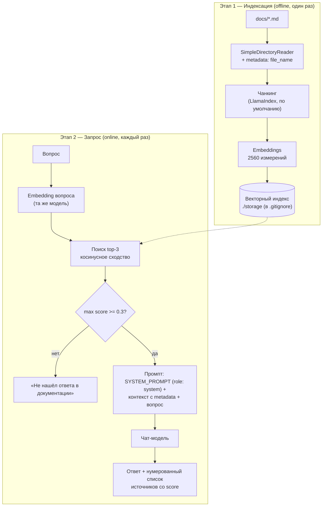

# qabrain — RAG-ассистент по QA-документации

Мини-проект. CLI-ассистент, который отвечает на вопросы
по QA-документации сетевого оборудования, опираясь только на неё, с цитированием
источников и логированием каждого запроса в Langfuse.

**Корпус:** 5 документов настройки маршрутизатора (VLAN, ACL, VRF, DNS, физические
интерфейсы).
**Результат тестирования:** 5/5 полезных ответов, 0 галлюцинаций.

---

## Метрики

| Показатель | Значение |
|---|---|
| Вопросов в тест-наборе | 5 |
| Полезных ответов | 5/5 |
| Галлюцинаций | 0/5 |
| Корректных отказов («нет в документации») | 2/5 |
| Мульти-источниковых ответов | 1/5 |
| Top-score релевантных запросов | 0.58–0.79 |
| Top-score нерелевантного запроса (OSPF) | 0.47 |

---

## Архитектура

Два этапа:



### Двойная защита от галлюцинаций

1. **Порог retrieval:** max score < 0.3 → отказ без вызова LLM.
2. **Системный промпт:** «отвечай только по контексту, иначе точная фраза отказа».

Кейс OSPF: top score 0.47 прошёл порог — отказал системный промпт, фраза точная.
Оба слоя необходимы: порог alone нерелевантное в домене не отсекает.

### Системный промпт

Место: `llm_setup.py`, параметр `system_prompt=` чат-модели — первое сообщение
`role: system` в каждом вызове.

> Ты — QA-ассистент по документации сетевого оборудования. Отвечай только по
> переданному контексту, не используй сторонние знания. Ссылайся на источники по
> имени файла из метаданных контекста. Если ответа в контексте нет — ответь ровно:
> «Не нашёл ответа в документации».

### Ключевые решения

| Решение | Выбор | Обоснование                                                                   |
|---|---|-------------------------------------------------------------------------------|
| Фреймворк | LlamaIndex | Документо-ориентированный RAG: node parsers, metadata, source nodes           |
| Чанкинг | Встроенный SentenceSplitter (1024 / overlap 200) | Для корпуса из 5 коротких документов достаточно                               |
| Векторное хранилище | In-memory индекс + персистенция в `./storage` | Простота MVP; `storage/` — артефакт, в `.gitignore`, пересоздаётся `index.py` |
| `similarity_top_k` | 3 | Комплексные вопросы требуют 2 источника + запас                               |
| Защита от галлюцинаций | Порог 0.3 + системный промпт | Двойной контур, см. выше                                                      |
| Цитирование | Нумерованный список источников со score (код) + имена файлов (модель) | Ответ QA-ассистента должен быть проверяемым                                   |
| Tracing | OpenTelemetry + OpenInference → Langfuse | Вендор-нейтральный стандарт                                                   |
| Конфигурация | `.env` + `config.py` в корне репозитория | Один конфиг на все недели, ключи не дублируются                               |

---

## Структура проекта

```
ai-engineering-journey/        # корень репозитория
├── .env                       # секреты — в репозиторий не попадает
├── config.py                  # общий конфиг всех недель (ключи, URL, имена моделей)
└── week03/
    └── qabrain/
        ├── docs/              # корпус: 5 QA-документов (.md)
        ├── storage/           # артефакт индекса — в .gitignore, пересоздаётся index.py
        ├── llm_setup.py       # модели + SYSTEM_PROMPT, одно определение на проект
        ├── tracing.py         # OpenTelemetry → Langfuse (OpenInference instrumentor)
        ├── index.py           # индексация корпуса (один раз)
        ├── query.py           # CLI для вопросов
        └── README.md
```

---

## Установка и запуск

```bash
pip install llama-index llama-index-llms-openai llama-index-embeddings-openai \
    langfuse openinference-instrumentation-llama-index \
    opentelemetry-sdk opentelemetry-exporter-otlp-proto-http
```

`.env` (в корне репозитория):

```bash
QWEN_API_KEY=...            # ключ OpenAI-совместимого вендора
QWEN_BASE_URL=...           # base URL вендора
CHAT_MODEL_NAME=...         # имя чат-модели
EMBEDDING_MODEL_NAME=...    # имя embedding-модели
LANGFUSE_BASE_URL=...
LANGFUSE_PUBLIC_KEY=...
LANGFUSE_SECRET_KEY=...
```

Запуск — из папки `qabrain/` (пути `./docs` и `./storage` относительны к cwd):

```bash
cd week03/qabrain
PYTHONPATH=../.. python index.py    # один раз: индексация docs/ → ./storage
PYTHONPATH=../.. python query.py    # CLI; exit для выхода
```

`PYTHONPATH=../..` подтягивает корневой `config.py`. В PyCharm не нужен: корень
проекта уже в `sys.path`.

---

## Пример сессии (реальный прогон)

```
❓ Вопрос: Как настроить OSPF (динамическую маршрутизацию) на маршрутизаторе?
============================================================
Не нашёл ответа в документации.
------------------------------------------------------------
Источники:
  [1] Настройка VRF.md (score: 0.47)
  [2] Настройка DNS.md (score: 0.43)
  [3] Настройка физических интерфейсов.md (score: 0.41)
============================================================
```

Точная фраза отказа — работа системного промпта: score выше порога 0.3,
сработал второй слой защиты. OSPF в корпусе действительно нет.

Каждый вопрос виден в Langfuse как trace со спанами embedding → retrieval → LLM.

---

## Тестирование

Набор из 5 вопросов по категориям отказов RAG: факт, деталь-ловушка, how-to,
комплексный, негативный в домене.

| # | Вопрос | Результат | Top score | Источник |
|---|---|---|---|---|
| 1 | Какой режим работы выбирается по умолчанию при создании VLAN? | ✅ Честный ответ «в документации не указано», без выдумывания | 0.64 | Настройка VLAN.md |
| 2 | Я добавил правило в ACL, а на следующий день оно исчезло. В чём моя ошибка? | ✅ Найден шаг-предупреждение Save → Apply | 0.58 | Настройка ACL.md |
| 3 | Как настроить VRF на маршрутизаторе? | ✅ Полная процедура | 0.79 | Настройка VRF.md |
| 4 | Как настроить физический интерфейс и создать для него VLAN? | ✅ Мульти-источник: оба документа | 0.71 / 0.66 | VLAN + интерфейсы |
| 5 | Как настроить OSPF (динамическую маршрутизацию)? | ✅ Отказ точной фразой через системный промпт | 0.47 | — (нет в корпусе) |

---

## Наблюдения и ограничения

**Эмпирическая шкала score (косинус вопрос ↔ чанк) для этого корпуса:**

| score | Интерпретация |
|---|---|
| 0.7–0.8 | Точное попадание в тему |
| 0.55–0.7 | Релевантно, основной источник |
| 0.4–0.55 | Смежная тема, «наименее непохожее» |
| < 0.4 | Шум |

- **Порог 0.3 не отсекает нерелевантное в домене.** OSPF получил 0.47 и прошёл
  порог; спас системный промпт. Граница «релевантное / нерелевантное» ≈ 0.5,
  с перекрытием → нужен rerank, а не калибровка порога.
- **top-k всегда возвращает k чанков**, независимо от релевантности.
- **Score — не вероятность правильности ответа**, а близость смыслов
  «вопрос ↔ текст»; не сравнима между embedding-моделями.
- **При отказе печатается список источников** — выглядит противоречиво;
  скрывать источники при отказе модели (точка расширения).
- **Inline-цитаты модели по именам файлов** запрошены системным промптом,
  проверяются прогоном how-to-вопроса после его добавления.
- **Пути `./docs` и `./storage` относительны к cwd** — запуск только из папки
  `qabrain/`; надёжнее `Path(__file__)` (точка расширения).

---

## Tracing: OpenTelemetry → Langfuse

- **Instrumentor:** `LlamaIndexInstrumentor` оборачивает LlamaIndex изнутри.
- **Экспортёр:** OTLP HTTP на `{LANGFUSE_BASE_URL}/api/public/otel/v1/traces`.
- **Auth:** `Basic` (base64 public:secret из `config.py`) + заголовок
  `x-langfuse-ingestion-version: 4`.
- **SimpleSpanProcessor:** синхронный экспорт — flush при выходе не нужен.

---

## Точки расширения

1. **Rerank** — лечение кейса OSPF; стандарт 2026.
2. **Кастомный `text_qa_template`** с нумерованным контекстом — строгие цитаты
   `[1]`, `[2]` от модели.
3. **Скрывать источники при отказе** модели.
4. **Agentic RAG:** классификатор запросов перед поиском.
5. **MCP-сервер:** обернуть qabrain и подключить к IDE/Claude.
6. **Evaluation:** датасет вопросов с работы + Ragas вместо ручного прогона.
7. **`Path(__file__).parent`** для `./docs` и `./storage` — независимость от cwd.

---

## Стек

Python 3.14 · LlamaIndex · Qwen3.8 · OpenTelemetry + OpenInference · Langfuse